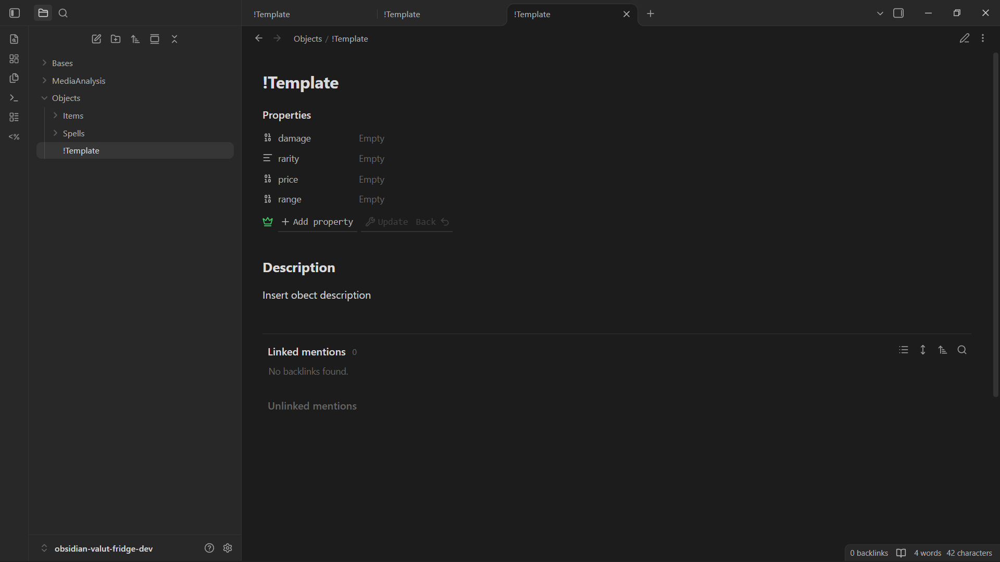
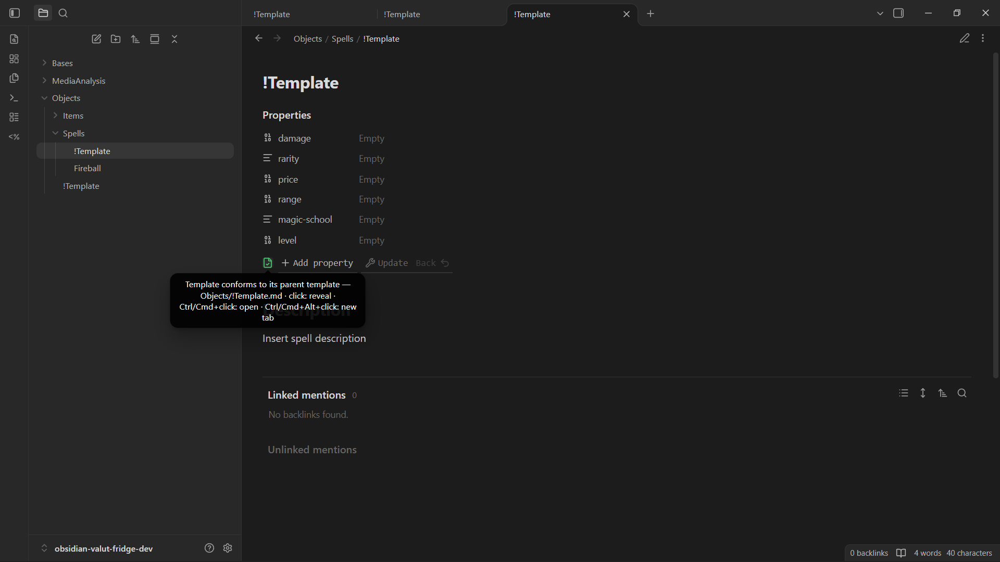
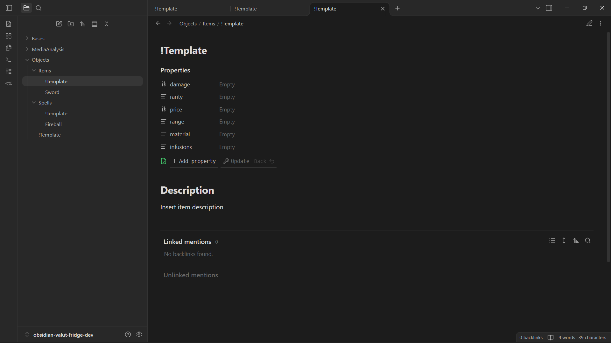
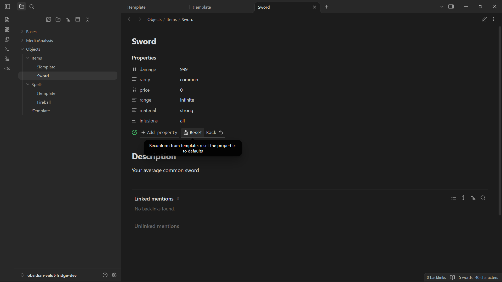
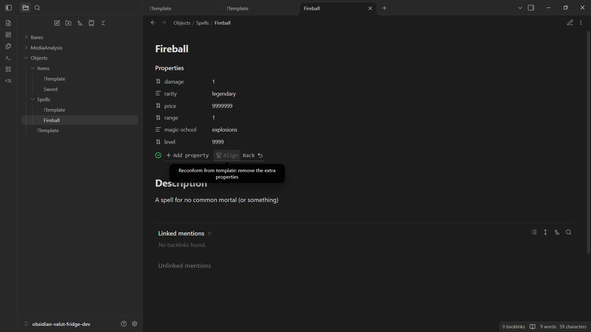
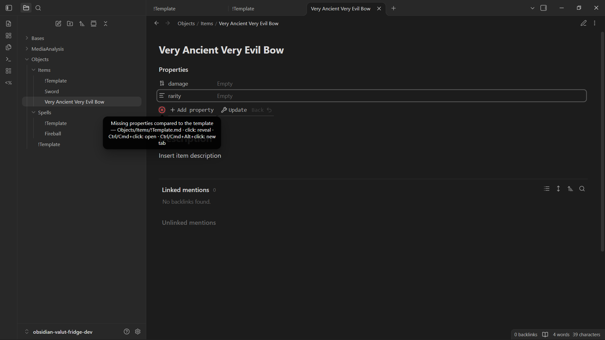
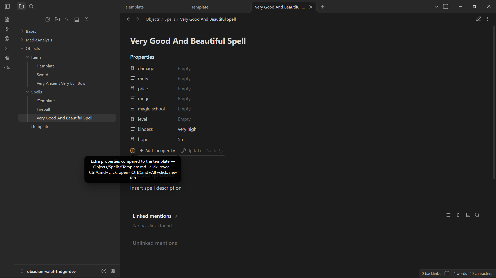

# Cascade Templates

A modular cascading templating system for [Obsidian](https://obsidian.md).

Assume that you want to track some media you consumed or some lightly-structured data in your vault, maybe some items and spells for your TTRPG campaign, or some notes from school across different subjects.

You would usually use Templater for such occurrences, but what happens when maybe an item needs a new property for durability, while maybe the spell doesn't use it... You could add a new field "durability" and keep it empty in spells, or maybe you could just link the /Items and /Spells folder to two different templates, but now you have no guarantee that the two templates are aligned with each other for all the common properties...

I struggled a bit with this kind of problem in my media tracking vault and came up with a solution that I believe might also be of use to someone else.

## Usage

You reserve a specific filename to mark the template file across the vault, by default "!Template.md", then each file checks if there is a template in its folder or, if not, in the folder above, recursively, and uses it as its reference template.

This is true also for template files: each template will check in the folders above for another template and will inherit its properties.
Now each template can extend the parent template adding new properties specific to that folder, while compatibility with the others is guaranteed.

Going back to the previous TTRPG-related example.

```
Objects/
├── !Template.md
├── Items/
│   ├── !Template.md
│   └── Sword.md
└── Spells/
    ├── !Template.md
    └── Fireball.md
```

Objects/!Template.md

```
---
damage:
rarity:
price:
range:
---

# Description
Insert object description
```

Objects/Items/!Template.md

```
---
damage:
rarity:
price:
range:
material:
infusions:
---

# Description
Insert item description
```

Objects/Spells/!Template.md

```
---
damage:
rarity:
price:
range:
magic-school:
level:
---

# Description
Insert spell description
```
Now you can have your common properties shared between Items and Spells with little to no setup, and without opening the settings for every new folder!!!

Objects/Items/Sword.md

```
---
damage: 999
price: 0
rarity: common
range: infinite
material: strong
infusions: all
---

# Description
Your average common sword
```

Objects/Spells/Fireball.md

```
---
damage: 1
rarity: legendary
price: 9999999
range: 1
magic-school: explosions
level: 9999
---

# Description
A spell for no common mortal (or something)
```

(Note that it is not limited to a single step, you can add as many layers and nested inheritance as you want :)

The other features of the plugin are related to make as easy as possible to reconform your current note or template to the parent, using a status icon to signal conformance and the addition of a multi-step button to the properties toolbar to force alignment to template changes.

## Screenshots















## Notes

No edit to existing notes will ever be done automatically: conformance is only a suggestion and is not granted in any way unless you perform actions explicitly, such as pressing a button.

"Update" will always adjust the properties order to match the template's.

This is meant to work alongside Templater script automations; the plugin exposes no scripting API of its own, and automatic filling is limited to inheritance and auto-apply on new notes.

## Features

### Template files

A template is a Markdown note named `!Template.md` (the name is configurable in the settings) whose YAML frontmatter defines the properties that notes in its scope are expected to carry. Its body is used as the initial content of new notes when body copying is enabled. Templates are ordinary vault files: they require no registration, are resolved with the same rules as notes, and their expressions are never evaluated by the plugin.

### Creating a template from a folder

Right-click a folder in the file explorer (long-press it on mobile) and choose **New root cascade template** or **New child cascade template**. The entry is disabled as **Cascade template already in folder** when the folder already has one. The same action is available from the command palette as **Create cascade template in current folder**, which targets the folder of the active note and reports an existing template with an error-toned notice. A root template starts with a single empty `edit` property so Obsidian shows the properties editor immediately: rename or replace it with the first real property. This is deliberate, because with empty frontmatter Obsidian renders no properties editor; like any other property, `edit` takes part in the cascade until it is replaced. The new file opens in a new tab and immediately inherits the properties of the nearest parent template, even when auto-apply is disabled; its body follows the auto-apply mode.

### Cascading templates

A template applies to the folder that contains it and to all its descendants, until a nested `!Template.md` overrides it. Every template resolves its own reference template among its ancestors and extends it, so properties shared across folders are defined once and each level adds only its own. Inheritance is recursive and has no depth limit.

### Auto-apply on new notes

When a note is created with an empty body, including a new nested `!Template.md`, the properties of its reference template are applied automatically, so the note starts conformant. Files that already contain content, such as notes arriving from sync or import, are left untouched. The settings expose three modes: disabled, properties only, properties and body. Creating a template from the folder menu or the command palette is explicit and always seeds its properties, regardless of the auto-apply mode.

### Template status icon

While a note is open, the properties toolbar shows an icon describing its relation to the reference template:

- conforming: the note has exactly the properties of the template;
- extra properties: the note defines properties that the template does not;
- missing properties: the note lacks properties defined by the template.

The tooltip reports the current state together with the path of the reference template.

### Template navigation

The status icon doubles as a navigation control for the reference template:

- Click: reveals the template in the file explorer;
- Ctrl/Cmd + Click: opens it in the current tab;
- Ctrl/Cmd + Alt + Click: opens it in a new tab.

On mobile, a tap reveals the template.

The same reference template can be opened from the command palette with **Navigate to parent template**, which always opens it in a new tab. On a template file, the command targets its parent template.

### Reconform from template

The reconform button in the properties toolbar cycles through three consecutive steps, from the least to the most invasive:

- Update: adds the missing properties and restores the template's order;
- Align: also removes the properties that the template does not define;
- Reset: restores the template's default values.

Back undoes the last step and rewinds the button. Existing notes are never modified unless the button is pressed, and the toolbar can be hidden on notes that have no template.

### Templater integration (optional, opt-in)

Template properties and bodies may contain `<% … %>` expressions, which templates preserve verbatim. The bridge is **off by default**: enable it in the plugin settings, read the warning and confirm it in the dialog before any evaluation happens. When it is on, the plugin evaluates the expressions while writing to a note, so the note receives the resulting value instead of the raw expression; when it is off, the values are copied verbatim and the reconform tooltip points this out.

The permission is stored **on the current device for the current vault only**, not in the synced vault data, so it must be enabled separately on every device where the vault is used; turning it off does not change any existing note. Evaluation is never applied to template files; script blocks (`<%* … %>`) execute code and should only be used in templates you trust.

### Settings

All behaviour is configured in the plugin settings, without any per-folder configuration:

- template file name;
- auto-apply mode (disabled, properties only, properties and body);
- Templater bridge, opt-in and stored per device (requires the Templater community plugin);
- toolbar visibility (always, or only when a template applies).

Each row can also be reached from Obsidian's global settings search.

## Compatibility

Cascade Templates requires **Obsidian 1.13.0 or later**, on desktop and mobile. The settings panel relies on the declarative settings API introduced in 1.13, so vaults on 1.11 or 1.12 no longer receive plugin updates.

## Installation

Manual installation:

1. Download `main.js`, `manifest.json` and `styles.css` from the latest release.
2. Put them in `<your-vault>/.obsidian/plugins/cascade-templates/`.
3. Enable "Cascade Templates" in Settings → Community plugins.

With [BRAT](https://github.com/TfTHacker/obsidian42-brat), add the repository URL and install the plugin from there.

## License

MIT. See [LICENSE](LICENSE).
