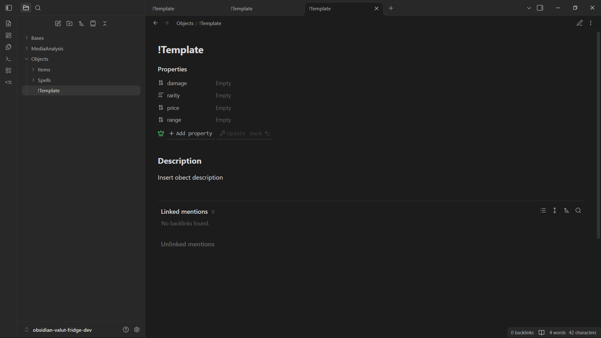
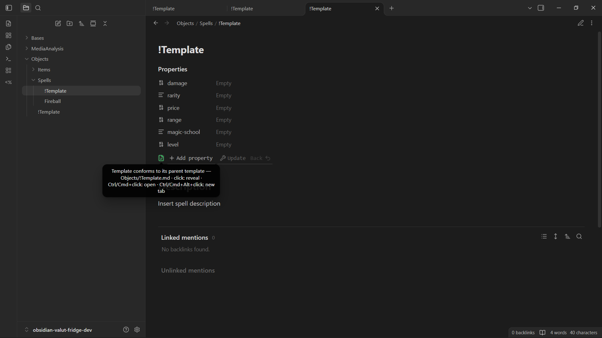
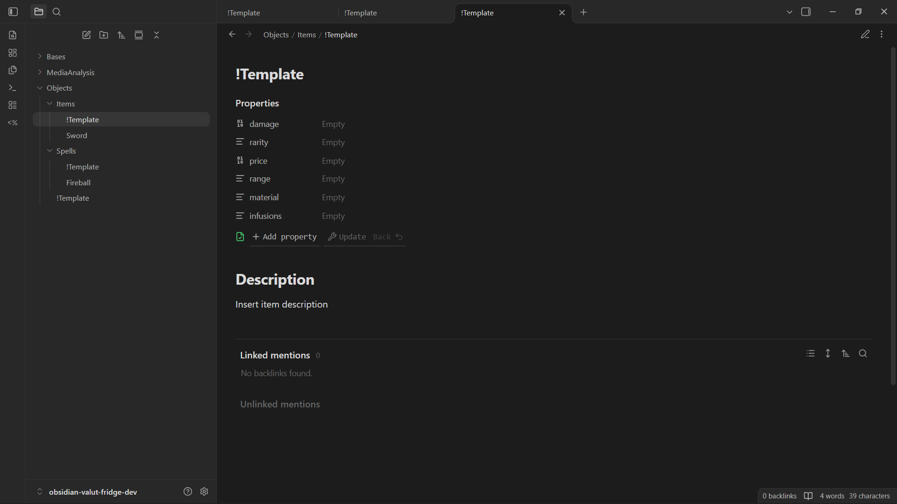
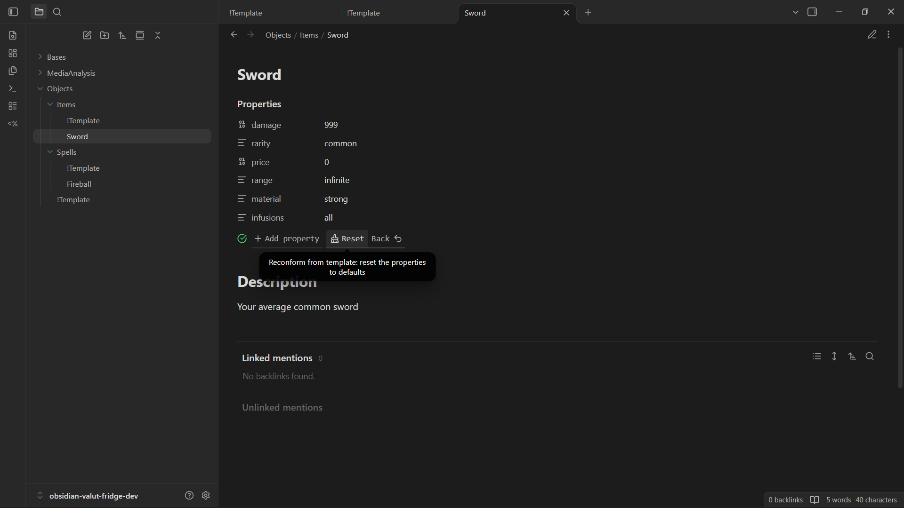
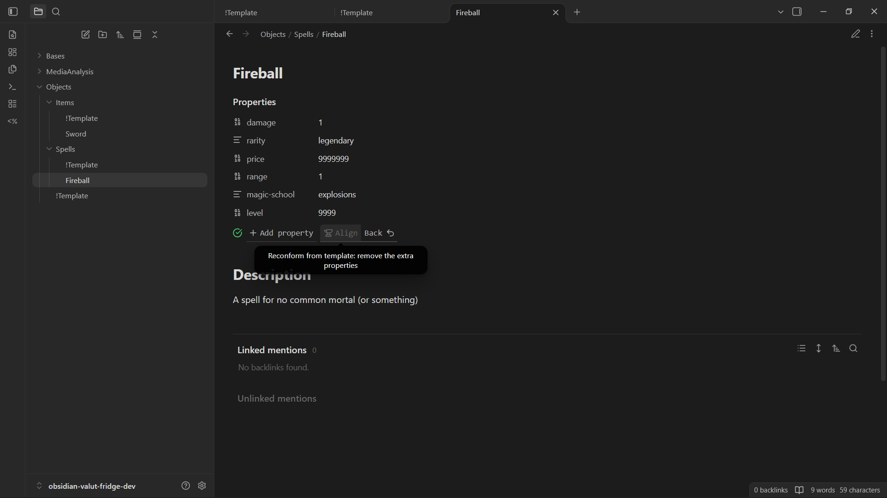
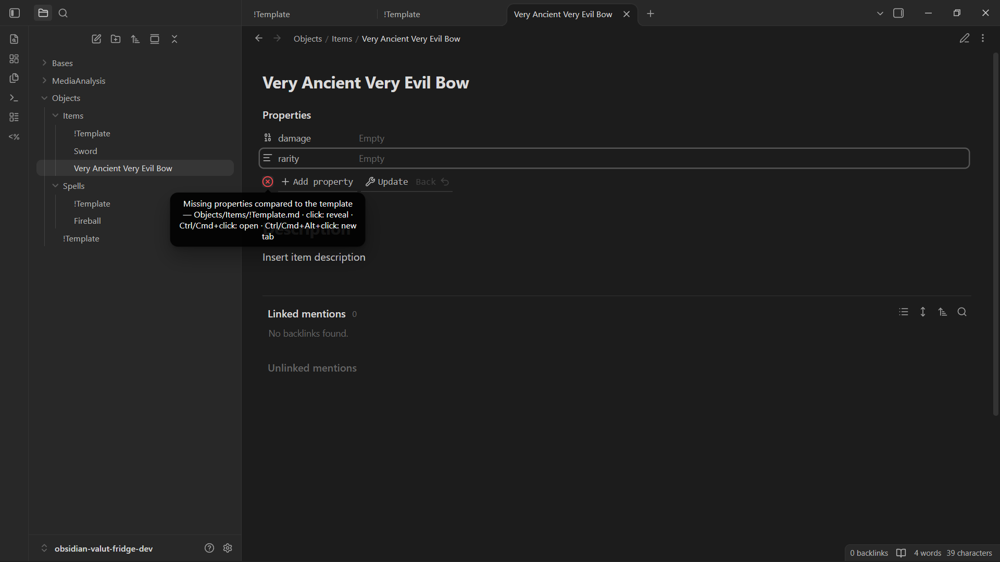
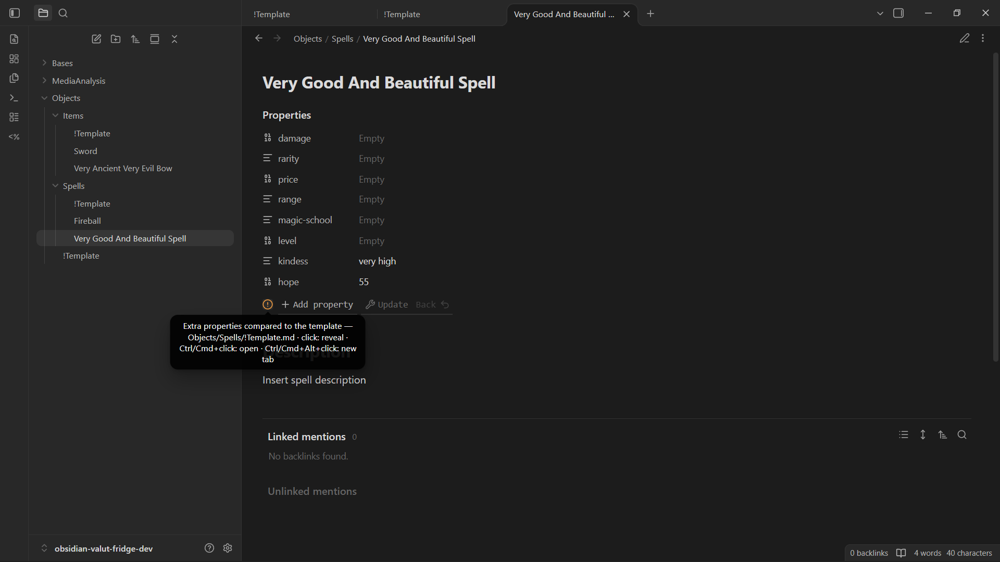

# Cascade Templates

A modular cascading templating system for [Obsidian](https://obsidian.md).

Assume that you want to track some media you consumed or some lightly-structured data in your valut, maybe some items and spells for your TTRPG campaign, or some notes from school across different subjects.

You would usually use templater for such occurences, but what happens when maybe an item needs a new property for durability, while maybe the spell doesn't use it... You could add a new field "durability" and keep it empty in spells, or maybe you could just link the /Items and /Spells folder to two different templates, but now you have no guarantee that the two templates are aligned with each other for all the common propertiers...

I struggled a bit with this kind of problem in my media tracking valut and came up with a solution that I believe might also be of use to someone else.

## Usage

You reserve a specific filename to mark the template file across the valut, by default "!Template.md", then each file checks if there is a template in ther folder or if not, in the folder above, recursively and uses it as his template of reference.

This is true also for template files: each template will check in the folders above for another template and will inherit its properties.
Now each template can extend the parent template adding new properties specifict to that folder, while compatibility with other is guaranteed.

Going back to the previous TTRPG related example.

```
Objects/
├── !Template.md
├── Items/
│   ├── !Template.md
│   └── Sword.md
└── Spells/
    ├── !Template.md
    └── Fireball.md
```

Objects/!Template.md

```
---
damage:
rarity:
price:
range:
---

# Description
Insert obect description
```

Objects/Items/!Template.md

```
---
damage:
rarity:
price:
range:
material:
infusions:
---

# Description
Insert item description
```

Objects/Spells/!Template.md

```
---
damage:
rarity:
price:
range:
magic-school:
level:
---

# Description
Insert spell description
```
Now you can have your common properties shared between Items and Spells with zero to no setup, and and without opening the settings for every new folder!!!

Objects/Items/Sword.md

```
---
damage: 999
price: 0
rarity: common
range: infinite
material: strong
infusions: all
---

# Description
Your average common sword
```

Objects/Spells/Fireball.md

```
---
damage: 1
rarity: legendary
price: 9999999
range: 1
magic-school: explosions
level: 9999
---

# Description
A spell for no common mortal (or something)
```

(Note that it is not limited to a single step, you can add as many layers and nested inheritance as you want :)

The other features of the plugin are releated to make as easy as possible to reconform your current note or template to the parent, using a status icon to signal conformance and the addition of a multi-step button to the properties toolbar to force allignement to template changes.

## Screenshohts















## Notes

No edit to existing notes will ever be done automatically: conformance is only a suggestion and is not granted in any way unless you perform actions explicitly, such as pressing a button.

"Update" will always adjust the props order to match the template ones.

This is ment to work alongside Templater script automations, therefore there is no native implementation for scripting and auto-filling props.

## Features

### Cascading templates

A template applies to the folder that contains it and to all its descendants, until a nested `!Template.md` takes over. This makes it possible to build progressively more specific schemas while keeping shared properties defined once.

### Auto-apply on new notes

When a new note (or a new nested `!Template.md`) is created with an empty body, the associated template's properties are merged in automatically. Optionally the template body is copied too. Files that already carry content, such as notes arriving from sync or import, are left alone. Auto-apply can be turned off in the settings.

### Template status icon

While a note is open, the metadata panel shows an icon describing its relation to the associated template:

- conforming to the template
- containing extra properties
- missing properties required by the template

### Own template finder

Several action are also implemented on status icon click to help template locating and navigation:
- Click: locates own Template in file explorer 
- Ctrl/Cmd + Click: opens own Template in current tab
- Ctrl/Cmd + Alt + Click: opens own Template in new tab

### Reconform from template

A single button in the metadata panel walks through three steps: Update (add all missing properties preserving order), Align (drop extra properties) and Reset (restore the template defaults). Back undoes the last step and rewinds the button. The toolbar can be hidden on notes that have no template.

## Installation

Manual installation:

1. Download `main.js`, `manifest.json` and `styles.css` from the latest release.
2. Put them in `<your-vault>/.obsidian/plugins/cascade-templates/`.
3. Enable "Cascade Templates" in Settings → Community plugins.

With [BRAT](https://github.com/TfTHacker/obsidian42-brat), add the repository URL and install the plugin from there.

## License

MIT. See [LICENSE](LICENSE).
